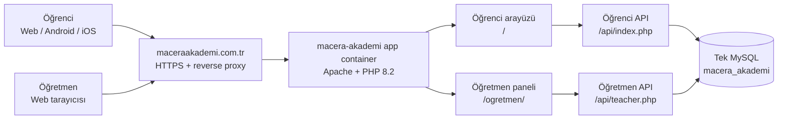
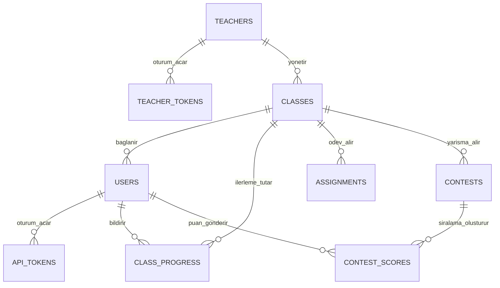

# Macera Akademi uygulama mimarisi

Bu belge canlıya alınacak birleşik yapıyı tarif eder. Öğrenci uygulaması ve
öğretmen paneli aynı GitHub deposundan, aynı Docker uygulama container'ından ve
aynı MySQL veritabanından çalışır.

## Genel görünüm

Şirketin reverse proxy'si HTTPS trafiğini varsayılan olarak
`127.0.0.1:8080` adresindeki uygulama container'ına aktarır. Sunucuda bulunan
diğer uygulamalar kendi container, port ve veritabanlarında çalışmaya devam
eder; Macera Akademi onlarla dosya veya işlem alanı paylaşmaz.

## Uygulama bileşenleri

| Yol / bileşen | Görevi |
|---|---|
| `/` | Öğrenci web uygulaması ve oyun kataloğu |
| `/ogretmen/` | Öğretmen kayıt/giriş, sınıf, ödev ve yarışma paneli |
| `/api/index.php` | Öğrenci hesapları, ilerleme, sınıf, arkadaşlık ve yarışma API'si |
| `/api/teacher.php` | Öğretmen hesabı, öğrenciler, ödevler ve yarışmalar API'si |
| `web/database/schema.sql` | Yeni kurulumun eksiksiz MySQL şeması |
| `web/database/migrations/` | Daha önce kurulmuş veritabanlarına uygulanacak değişiklikler |

Android ve iOS uygulamaları öğrenci web uygulamasını WebView içinde kullanır.
Öğrenci ekranındaki **Öğretmen misiniz?** bağlantısı aynı yayının
`/ogretmen/` yolunu açar. Eski Netlify öğretmen sitesi canlı mimarinin parçası
değildir.

## Tek veritabanındaki veri ilişkileri

- `teachers` ve `teacher_tokens`: öğretmen hesabı ile tek yönlü özetlenmiş
  oturum belirteçleri.
- `classes`: öğretmene ait aktif sınıf kodu. Kod yenilenince eski sınıf kaydı
  silinmez, pasif yapılır.
- `users` ve `api_tokens`: öğrenci hesabı ile öğrenci oturumları.
- `class_progress`: öğrencinin seviye, XP ve tamamladığı oyun kimlikleri.
- `assignments`: öğretmenin seçtiği oyunlardan oluşan ödevler.
- `contests` ve `contest_scores`: günlük/haftalık yarışmalar ile puan sıralaması.

Öğretmen API'si her istekte kaydın öğretmenin aktif sınıfına ait olduğunu
kontrol eder. Bir öğretmen başka bir öğretmenin ödevini, yarışmasını veya
öğrenci listesini okuyamaz/değiştiremez.

## Temel veri akışları

### Öğrencinin sınıfa katılması

1. Öğretmen paneli hesap açarken altı karakterli sınıf kodu üretir.
2. Öğrenci kodu profil ekranına girer.
3. Öğrenci API'si kodu `classes` tablosunda doğrular ve öğrenciyi sınıfa bağlar.
4. Öğrenci ilerlemesi `class_progress` tablosuna gönderilir.
5. Öğretmen paneli aynı tablodan güncel öğrenci listesini gösterir.

### Ödev ve yarışma

1. Öğretmen paneli seçimi öğretmen API'sine gönderir.
2. API, öğretmen-sınıf sahipliğini doğrulayıp kaydı MySQL'e yazar.
3. Öğrenci uygulaması sınıf verilerini öğrenci API'sinden alır.
4. Yarışma sonucu `contest_scores` tablosuna yazılır.
5. Öğretmen paneli sıralamayı aynı MySQL kaydından okur.

## Dağıtım seçenekleri

Uygulama container'ı her iki seçenekte de aynıdır:

1. **Şirket MySQL'i:** `app` container'ı şirketin mevcut MySQL/MariaDB
   sunucusundaki yalnızca Macera Akademi'ye ayrılmış veritabanına bağlanır.
2. **Birlikte MySQL container:** Compose'un `bundled-db` profili `app` yanında
   özel bir MySQL 8 container'ı ve kalıcı volume açar.

Her iki seçenekte de uygulamanın gördüğü mantıksal veritabanı tektir; öğrenci
ve öğretmen için ayrı Firebase/MySQL veritabanları kullanılmaz.

## Güvenlik ve işletim sınırları

- Canlı trafik HTTPS üzerinden gelmelidir.
- MySQL ve root parolaları yalnızca sunucudaki `.env`/secret yönetiminde tutulur.
- Repo, Docker image veya mesajlarda gerçek parola bulunmamalıdır.
- Öğrenci ve öğretmen parolaları PHP `password_hash` ile saklanır.
- Ham oturum anahtarı veritabanına yazılmaz; yalnız SHA-256 özeti tutulur.
- MySQL düzenli yedeklenmelidir.
- Eski Firebase, yetkili dışa aktarım ve doğrulanmış geçiş tamamlanmadan
  silinmemelidir.

Kurulum komutları için kökteki `DOCKER_KURULUMU.md`, günlük kullanım için
`docs/KULLANIM_KILAVUZU.md`, eski verilerin durumu için
`docs/FIREBASE_MYSQL_GECISI.md` kullanılmalıdır.
